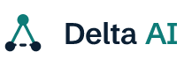

 
 

<strong>ARCHITECTURE-FIRST BACKEND GENERATOR</strong>

<h3>Design the backend system before you write it.</h3>

Describe your product. Delta AI designs a scalable, secure backend architecture,
writes the specification for every service, and opens the pull requests in your
GitHub organisation. Your code, your cloud, no lock-in.

<strong>This repository is part of a complete backend system generated by Delta AI
from a single product description.</strong>
See the <a href="https://github.com/delta-ai-dev-ext/discord-like-platform-usecase">full showcase</a>
to explore the architecture, the specifications and all six services.

<a href="https://app.delta-ai.dev"><strong>Start building →</strong></a>
&nbsp;&nbsp;·&nbsp;&nbsp;
<a href="https://delta-ai.dev">delta-ai.dev</a>
&nbsp;&nbsp;·&nbsp;&nbsp;
<a href="https://app.delta-ai.dev/docs">Documentation</a>

---

# 3b75-discord-style-real-time-communication-platform-system-design